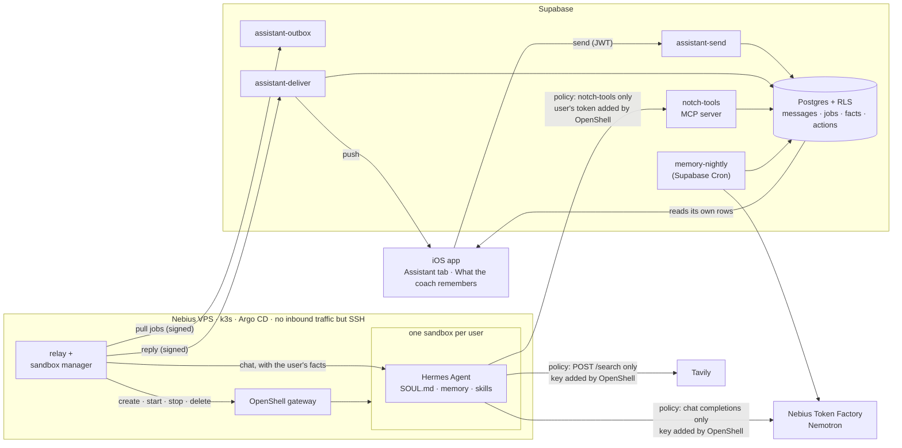

# Notch — a personal strength coach that remembers you and acts for you

Notch is an iOS app with an AI coach that runs a lifter through their workout
set by set, logs every rep and plans progressive overload. It has been on the
App Store since before the hackathon.

For the **Nebius × NVIDIA Global AI Hackathon (Personal AI track)** we added
the **Coach assistant**: an always-on personal coach you can talk to between
workouts. It remembers what matters about you across sessions, looks things
up on the web with sources, changes your training plan when you ask — and lets
you undo it — and checks in every day on its own. Every user gets their
own agent: **Hermes Agent running in their own NVIDIA OpenShell sandbox**,
thinking with **NVIDIA Nemotron on Nebius Token Factory**.

- **Demo build:** ⟨public TestFlight link⟩
- **Demo video:** ⟨YouTube link⟩
- **Judge accounts:** in the Devpost testing instructions (never in this public repository)

> **Status on 2026-10-24.** Live on one Nebius VPS since 2026-10-20: a dev
> and a prod environment, each with its own OpenShell gateway, relay and
> per-user sandboxes; prod runs the images dev ran first. The hackathon build
> ("Notch Coach", TestFlight only) passed Beta App Review on 2026-10-23 and is
> on a public TestFlight link. The nightly memory job and the daily check-in
> run on schedule, and My Coach — plans and the in-workout coach — runs on
> Nemotron too. [The plan](docs/nebius-hackathon-plan.md) tracks every item;
> [the board](docs/deploy-status.md) has the details.

## What the Coach assistant does

| | |
|---|---|
| **Talks with you between workouts** | A new *Assistant* tab in the app, separate from the in-workout coach. Replies arrive in the chat and as a push notification. |
| **Remembers you** | A nightly job distils short, typed facts from your chats and workouts — injuries, goals, schedule, equipment, preferences. *What the coach remembers* lists them; delete any and the coach stops using it. |
| **Acts on your behalf** | Saves notes for your next workout and changes an exercise's sets, rep range, rest, intensity or warm-up — never the movement itself. Every change is recorded, stated exactly, and undoable for 24 hours. |
| **Looks things up** | Web search through Tavily for nutrition facts, substitutions and equipment, with sources you can tap. The coach's rules keep personal details out of every query. |
| **Checks in** | A daily message at 06:00 UTC about today's workout and one thing it remembers — or nothing, when there's nothing useful to say. |
| **Stays private** | Your agent runs in its own sandbox; its memory, skills and sessions are yours alone. It never holds an API key, and it reaches your training data only through tools that check every read and write against the database. |

## How Nemotron and Token Factory are used

Every model call in the hackathon build goes to **Nebius Token Factory**
(`https://api.tokenfactory.nebius.com/v1`, OpenAI-compatible), and every one
uses **NVIDIA Nemotron**:

| Where | Model | Why this one | How it's called |
|---|---|---|---|
| Every Coach assistant reply and daily check-in | Nemotron **Super** (`TOKEN_FACTORY_MODEL`) | Interactive: a person is waiting, and the turn calls tools, so it needs reliable tool calling at low latency and cost | By Hermes, inside the user's sandbox, through a provider entry for Token Factory in its config. The key never enters the sandbox: OpenShell's proxy adds it to the request, and only for Token Factory's host. A little thinking — every request carries `reasoning_effort: "low"`, set in that provider entry because Hermes' built-in Token Factory provider doesn't send it. With thinking off, a turn that came after an earlier exchange called the tool it needed in only 6 of 16 — it promised, or claimed an action it never took; with `low`, 16 of 16. More would risk the opposite: a reasoning model can spend its whole budget thinking and answer with nothing |
| The nightly memory job | Nemotron **Ultra** (`MEMORY_MODEL`) | A batch job nobody waits for: quality over latency, and thinking on | From a Supabase Edge Function (`memory-nightly`) with a JSON-schema response; every operation it proposes is validated, and the facts' scores are computed in code, not by the model |
| My Coach: plan generation and the in-workout coach | Nemotron **Super** (`COACH_MODEL`, `COACH_PLAN_MODEL`) | A lifter is mid-set: replies in 1 to 2.5 s. For plans, Super and Nemotron Lightning were both valid every time in Hebrew and English; Super was faster in Hebrew (4.7 s against 10.0 s at the median), for 0.14 cents a plan | The in-workout coach's existing LangGraph code runs inside the `session-start` and `coach-turn` Edge Functions, its model client pointed at Token Factory: thinking off for a plain reply, `low` for the turn that calls a tool. `plan-generate` holds Nemotron to the plan's JSON schema, and the warm-up on each plan's first heavy compound is set in code |

Spend is bounded by construction: `_shared/assistant.ts` prices every call
from the usage Token Factory reports (a conservative fallback when it
doesn't), and at a daily ceiling the assistant says the day's limit is
reached and nothing more is sent. The ceilings follow a schedule in code:
prod $0.35 a day ($2 while judging runs, 2026-12-01 to 12-15), dev $0.30
and then less until it closes on 11-15, the memory job $0.10 ($0.20 while
judging), My Coach $0.15 ($0.60 while judging) — a worst case of $68.45 to
12-15, every bucket at its ceiling every day. Hermes' own background model
calls (post-turn reviews, session titles), whose tokens no one could count,
are switched off.

The live App Store app is unchanged: its in-workout coach stays on Google
Gemini through OpenRouter. Importing a plan from pasted text, a file or a
photo still needs that service, so it isn't available in the hackathon
build.

## Architecture

A message's path: **the app → Supabase Edge Functions → the job queue
(outbox) → the relay on the Nebius VPS → the user's own OpenShell sandbox →
Hermes Agent → Nemotron on Token Factory**, with Tavily search and our tools
reached only through the sandbox's network policy — and the reply back the
same way.



- **The app** sends a message to `assistant-send`, which checks the feature
  flag, the subscription, rate limits and the daily caps, stores the message
  and queues a job. Replies land in the user's own rows, which the app reads
  under row-level security.
- **The relay** on the VPS pulls jobs from `assistant-outbox`: the VPS accepts
  no inbound connections, and every request is HMAC-signed per environment.
  For each job it takes the user's sandbox from the **sandbox manager**, sends
  the conversation plus the user's facts — marked as information, never as
  instructions — to that sandbox's Hermes, and posts the reply to
  `assistant-deliver`. A retried delivery is never stored or pushed twice.
- **The sandbox manager** creates a user's sandbox on their first message,
  starts it when a message arrives, stops it after 10 idle minutes and deletes
  it once the account is gone. At most 4 sandboxes run at once in prod
  (2 in dev); a user who doesn't fit waits in the queue, in order, and is
  never served from someone else's sandbox.
- **Hermes** in each sandbox reads the coach's character and rules from
  `SOUL.md` and has exactly four toolsets: the Notch tools, web search, its own
  memory and skills. Terminal, files, code execution and the browser are off.
- **The sandbox's network policy** (`deploy/platform/openshell/sandbox-policy.yaml`)
  lets exactly one binary, Hermes' interpreter, reach exactly three places:
  Token Factory's chat completions, Tavily's `POST /search` and our
  `notch-tools`. Everything else — Tavily's other endpoints, any other host,
  the cluster — is refused.
- **`notch-tools`** is our MCP server: four read tools (profile, plans,
  history with progression computed in code, facts) and three write tools
  (`save_note`, `adjust_plan_exercise`, `undo_last_change`). A tool never takes
  a user id from its arguments; the per-user token decides whose data it is.
- **Memory** has two layers. Canonical is Notch's list of up to 15 typed facts
  per user, scored in code and shown to the user. Hermes' own memory keeps
  coaching know-how only; its user-profile store is off, so a fact the user
  deletes can't live on inside the agent.
- **My Coach** in the hackathon build — plan generation and the in-workout
  coach — runs in Edge Functions (`plan-generate`, `session-start`,
  `coach-turn`) on Nemotron Super, behind the same `assistant_chat` flag and
  with its own daily ceiling.
- **The cluster** is one k3s node that Argo CD keeps in sync with
  [`deploy/`](deploy/README.md) on `main`. CI builds the images after green
  tests and commits their tags; Argo CD pulls them. A prod sync window freezes
  the demo during judging.

## Security

**A prompt-injection hole in Hermes, closed here and fixed upstream.** Hermes
trusts an `[OUT-OF-BAND USER MESSAGE]` marker as the user's own voice, and
any tool result — a web page, a file, an MCP response — can carry one. We
independently found it while auditing the prompt Hermes sends; it is tracked
upstream as the open issue [#81828](https://github.com/NousResearch/hermes-agent/issues/81828). On our stack a forged marker in
a search result took over the reply in 10 of 10 turns; our build-time patch
([`patch-hermes-prompt.py`](deploy/images/hermes-sandbox/patch-hermes-prompt.py))
takes it to 0 of 10, and the fix is submitted to Hermes as
[PR #143928](https://github.com/NousResearch/hermes-agent/pull/143928).

What we guard against: one user's agent reaching another user's data, anyone's
keys leaving the gateway, and a web page steering the agent. Checked on the
live cluster with two test accounts (NH-26 on 2026-10-19, NH-45 on 10-20 and
10-21) — our own tests, not an external audit:

- **One sandbox per user, closed from inside.** From inside a user's sandbox:
  no Kubernetes service-account token; nothing key-shaped in the environment —
  the Token Factory key, the Tavily key and the user's tool token are
  OpenShell's placeholders; nothing writable but `/sandbox` and `/tmp`; no
  volume but its own. No direct connection — from a shell, or from Hermes'
  own interpreter, the one binary the policy lets out — to the other user's
  sandbox, the gateway, the node's ports, the cluster API, the cloud metadata
  service or the internet. The positive control: the same interpreter reaches
  Token Factory.
- **Keys bound to their hosts.** OpenShell's proxy puts the real key in only
  on requests to that key's own host. Each placeholder sent to another
  provider's host — in a header, or in Tavily's request body — got a 403
  (`credential_endpoint_mismatch`) and went nowhere; to its own host, 200.
- **From the agent's side.** The request Hermes sends the model carries
  exactly the twelve tools we allow; six prompts after keys, the tool token,
  a shell, a file, a fetched page and another user's data got nothing. Asked
  something only user B's facts answer, B's agent knew and A's didn't.
- **No forged instructions from a tool result.** The marker above: with
  `web_search` stubbed to return a page with a forged marker and an
  instruction, the model obeyed it in **10 of 10** turns before our third
  patch to Hermes and in **0 of 10** after — on the image as CI builds it,
  too. The patch relabels the marker in every tool result and drops the note
  that says to trust it.
- **No way in.** From outside, the VPS answers SSH only; the relay pulls its
  work from Supabase over HMAC-signed requests; NetworkPolicies keep dev and
  prod apart; a tool takes the user from the per-user token, never from the
  model.

## Measured on the live system

The spike (NH-21 to NH-27) and the runs after it, on the same VPS, with the
Hermes image as CI builds it and Nemotron on Token Factory:

| What | Result | When |
|---|---|---|
| The soak: one turn a minute for 15 hours | 900 turns, none failed or empty; p50 4.9 s, p95 7.9 s, the same at the end as at the start. Hermes' memory levelled off at 300–304 MiB — no leak | 2026-10-18/19 (thinking off) |
| A ten-turn conversation with history (`bench turns`, three runs) | p95 5.0 to 10.0 s; $0.048 to $0.052 per 10 turns at Super's list price | 2026-10-19 (`low`) |
| Tool calls when a turn needs one | 40 of 40; 16 of 16 after an earlier exchange; none of 160 turns empty | 2026-10-18 (`low`) |
| Cold start | A stopped sandbox: 17 to 19 s to the first reply; a new one, 34 to 39 s. About one start in seven waits 2 min 16 s more for OpenShell 0.1.2's supervisor — so the demo and judge accounts' sandboxes are created ahead and kept running | 2026-10-18 |
| Capacity, 2 vCPU / 8 GiB | Six sandboxes running, three with turns at once: p95 6.8 to 8.1 s, 4.2 GiB still free | 2026-10-18 |
| A gateway restart under running sandboxes | The sandboxes live through it; a message that arrives meanwhile waits, keeps its attempts, and is answered 15 to 20 s later | 2026-10-21 |
| The relay's long polling | About 3,500 Edge Function calls a day for both relays, against 86,000 polling every 2 s | 2026-10-16 |
| The nightly memory job, first real run (Ultra) | 4 users from their seeded history in 25 s, about 6 s a user — one call fits about 12 users before its 75 s cut-off; 25 facts kept, none dropped | 2026-10-23 |
| The memory evaluation set: 12 chats with expected facts (Ultra) | Recall 1.00 in both runs; precision 0.79 and 0.92 — a miss is a fact kept from a coach-only statement or from small talk, which varies run to run; about 3 cents a run | 2026-10-23 |
| My Coach on Nemotron Super | A plan in 4.7 s (Hebrew) and 5.3 s (English) at the median, 0.14 cents; a workout's start 0.8 to 1.5 s, the turn that logs sets 2.0 to 2.3 s with every set logged right; 0.4 cents a free-text turn | 2026-10-22 |
| The daily check-in | Queued at 06:00 UTC for the four demo and judge accounts, all delivered within 17 to 50 s (the spare account's sandbox started for it) | 2026-10-24 |

## What we built, and what we build on

OpenShell, Hermes Agent and NemoClaw's Hermes sandbox image are the runtime;
the product is the software around them. None of the upstream source is vendored
in this repository: each piece is pulled at a pinned version, under its own
license. Three patches change Hermes when our sandbox image is built, and each
fails the build if Hermes' code isn't what it was written for: its API server
also takes its key from an `X-Hermes-Api-Key` header (OpenShell's gateway
removes `Authorization`); a gate NemoClaw adds, which holds every turn until a
directory belongs to root, is switched off, because on a Kubernetes volume it
never does; and the prompt patch above, which also stops Hermes filing the
user's preferences into skills, where nothing about the user belongs
([why](deploy/images/hermes-sandbox/README.md#our-patches-to-hermes)).

| Ours (MIT, this repository) | Where |
|---|---|
| The MCP tool server over real training data, with the audit trail and undo | `supabase/functions/notch-tools`, migrations `20260928*` |
| The chat channel: queue with leases, deferral and per-user ordering, signed relay endpoints, idempotent delivery | `supabase/functions/assistant-*`, `_shared/relay-auth.ts` |
| The relay and the per-user sandbox manager | `services/relay` |
| The memory pipeline: extraction with per-operation validation, scoring and eviction in code, nightly job, evaluation set | `_shared/memory-*.ts`, `supabase/functions/memory-nightly`, `supabase/eval/memory` |
| The coach's character and rules, the tool allowlist, the sandbox's start script, the three patches to Hermes | `deploy/images/hermes-sandbox` |
| Spend ceilings, the kill switch, operations runbooks | `_shared/assistant.ts`, `docs/assistant-ops.md`, `docs/budget-runbook.md` |
| GitOps: bootstrap, Argo CD app of apps, NetworkPolicies, image pipeline | `deploy/`, `.github/workflows/images.yml` |
| Encrypted nightly backups, the restore onto a new host, the health check | `deploy/ops` |
| The Assistant and memory screens | `apps/mobile/app/(tabs)/coach.tsx`, `apps/mobile/app/coach-memory.tsx` |
| Numbers computed in code, never by the model: the history tool's progression summary, and the in-workout targets (pre-existing) | `notch-tools/read-tools.ts`, `services/agent/src/progression.ts` |

| Upstream | License | How it's used |
|---|---|---|
| [NVIDIA OpenShell](https://github.com/NVIDIA/OpenShell) | Apache-2.0 | Gateway Helm chart 0.1.2 and the `openshell` CLI (shipped in the relay image with its LICENSE and THIRD-PARTY-NOTICES) |
| [Hermes Agent](https://github.com/NousResearch/hermes-agent) (Nous Research) | MIT | The agent in every sandbox, as NemoClaw's image ships it (v0.21.3), with our three patches: to its API server's key check, to the cron-restore drain gate NemoClaw adds, and to what tool results and its own guidance put in the prompt — the last one submitted upstream as [PR #143928](https://github.com/NousResearch/hermes-agent/pull/143928) |
| [NVIDIA NemoClaw](https://github.com/NVIDIA/NemoClaw) | Apache-2.0 | Its published Hermes sandbox image (v0.0.130, pinned by digest) is the base of ours; we add the coach's profile and start Hermes with our own script, not with its start script or its `hermes` wrapper |
| [Agent Sandbox](https://github.com/kubernetes-sigs/agent-sandbox) | Apache-2.0 | The Sandbox CRD and controller OpenShell runs on, v1.0.4 |
| [k3s](https://github.com/k3s-io/k3s), [Argo CD](https://github.com/argoproj/argo-cd) | Apache-2.0 | The cluster and its GitOps sync |

## Repository layout

| Path | What |
|---|---|
| `apps/mobile` | Expo (React Native) iOS app |
| `apps/web` | Next.js landing and legal pages |
| `services/agent` | The in-workout coach service (Fly.io, Gemini) — unchanged for real users |
| `services/relay` | The relay and the sandbox manager (Node, runs on the cluster) |
| `supabase/migrations` | Postgres schema and RLS; hackathon migrations are additive only |
| `supabase/functions` | Edge Functions (Deno); `_shared` holds the shared modules |
| `supabase/cron` | Cron schedules, applied by hand after the functions are deployed |
| `supabase/eval/memory` | Golden set and runner for the memory evaluation |
| `deploy` | The cluster: bootstrap, Argo CD apps, manifests, the Hermes sandbox profile |
| `packages/shared` | Design tokens and domain types |
| `docs` | The hackathon plan, brief and runbooks |

## Engineering rules

- Clients never call a model directly: the in-workout coach goes through the
  agent service, the Coach assistant through the queue and the relay. Usage
  caps, prompt assembly and the kill switches live on the server.
- All client database access is row-scoped by RLS; writes go through Edge
  Functions. The assistant writes only through `notch-tools`, which validates
  every change against the database and records it.
- Numbers the user sees — targets, progress — come from code, never from
  model prose.
- An active workout keeps working offline; sets queue on the device and sync.
- Replies are single complete messages in the user's language.
- During the hackathon, real users keep today's app: new features sit behind
  per-account flags, and migrations are additive only.

## Setup

Requirements: Node 22, pnpm 9.15.9, Deno 2, the Supabase CLI; EAS for app
builds; a Linux host (Ubuntu 24.04) for the cluster.

```bash
pnpm install
pnpm typecheck
pnpm test
```

### Supabase

```bash
supabase link --project-ref <project-ref>
supabase db push
supabase secrets set --env-file supabase/functions/.env
supabase functions deploy
```

Without a name, `functions deploy` deploys every function in
`supabase/functions`: the assistant's (`assistant-send`, `assistant-outbox`,
`assistant-deliver`, `notch-tools`, `memory-nightly`) and the app's own
(`plan-generate`, `plan-import`, `session-start`, `coach-turn`,
`session-complete`, `accept-terms`, `account-delete`, `dev-test-login`,
`history-import`, `studio-session`, `revenuecat-webhook`). My Coach's three
model functions need `COACH_TOKEN_FACTORY_API_KEY`; `plan-import`'s parsing,
`history-import` and `studio-session` need the agent service (`AGENT_URL`)
and answer 503 without it. `notch-tools`, `assistant-outbox`,
`assistant-deliver`, `memory-nightly` and `revenuecat-webhook` are called
without a user JWT (the sandbox's token, the relay's signature, the cron
secret, the webhook's secret), so `verify_jwt` is off for them in
`supabase/config.toml`. Then
apply `supabase/cron/assistant.sql` in the SQL editor for the nightly memory
job and the daily check-in. Turn the assistant on per account with the
`assistant_chat`, `assistant_memory` and `assistant_checkin` flags;
[`docs/assistant-ops.md`](docs/assistant-ops.md) has the queries, the kill
switch and the daily checks.

Secrets (`supabase/functions/.env`, from `.env.example`):

| Variable | What |
|---|---|
| `ASSISTANT_RELAY_SECRET_PROD`, `ASSISTANT_RELAY_SECRET_DEV` | HMAC secrets the relay signs with, one per environment (≥ 32 characters) |
| `ASSISTANT_SPEND_CEILING_CENTS_PROD` / `_DEV` / `_MEMORY` / `_COACH` | Override a daily Token Factory ceiling; without them the ceilings follow D-34's schedule by date (`supabase/functions/_shared/assistant.ts`) |
| `COACH_TOKEN_FACTORY_API_KEY`, `COACH_MODEL`, `COACH_PLAN_MODEL` | My Coach on Token Factory: the in-workout coach and plan generation, Nemotron Super unless a model is set |
| `ASSISTANT_DAILY_MESSAGES_PER_USER`, `ASSISTANT_DAILY_MESSAGES_GLOBAL` | Daily message caps (100 / 1000) |
| `ASSISTANT_ALLOWED_ORIGINS` | Browser origins for the assistant endpoints; empty for the app |
| `MEMORY_TOKEN_FACTORY_API_KEY`, `MEMORY_MODEL` | The nightly job's Token Factory key and Nemotron model id |
| `MEMORY_CRON_SECRET` | Shared with the cron job through Vault (≥ 32 characters) |
| `AGENT_URL`, `AGENT_SHARED_SECRET` | The agent service, for what isn't on Token Factory yet (plan import, the studio session, history import); not set on the hackathon's project |
| `REVENUECAT_WEBHOOK_SECRET`, `SUBSCRIPTION_PAUSED`, `USAGE_MONTHLY_BUDGET_CENTS` | Subscriptions and the per-user cost breaker |
| `DEV_TEST_LOGIN_EMAILS` | Accounts that sign in without a code (QA, review, demo); random addresses only |
| `SENTRY_DSN`, `SENTRY_ENVIRONMENT` | Error reporting, optional |

### Mobile app

`apps/mobile/.env` from `.env.example`: `EXPO_PUBLIC_SUPABASE_URL`,
`EXPO_PUBLIC_SUPABASE_ANON_KEY`, `EXPO_PUBLIC_REVENUECAT_API_KEY_IOS`,
`EXPO_PUBLIC_SUBSCRIPTION_PAUSED`, and optionally `EXPO_PUBLIC_SENTRY_DSN`,
`EXPO_PUBLIC_POSTHOG_KEY`, `EXPO_PUBLIC_POSTHOG_HOST` and (dev builds only)
`EXPO_PUBLIC_DEV_TEST_ACCOUNTS`.

```bash
pnpm --filter @gymcoach/mobile start
```

### In-workout coach service and website

The hackathon app runs `services/agent`'s coach inside `session-start` and
`coach-turn`, on Token Factory; this repository doesn't deploy it to Fly. The
live app's service on Fly.io takes `OPENROUTER_API_KEY`, `AGENT_SHARED_SECRET`,
and optionally `SENTRY_DSN`, `SENTRY_ENVIRONMENT`, `AGENT_DISABLED`. The website
(`apps/web`, Vercel): `NEXT_PUBLIC_SUPABASE_URL`, `NEXT_PUBLIC_SUPABASE_ANON_KEY`.

### The cluster

[`deploy/README.md`](deploy/README.md) is the full runbook. In short, on a
hardened Ubuntu 24.04 host:

```bash
sudo deploy/bootstrap/bootstrap.sh
sudo deploy/bootstrap/secrets.sh prod /etc/notch/prod.env
sudo deploy/ops/install.sh
```

The first installs pinned k3s and Argo CD core and hands everything else to
Argo CD; the second loads one environment's secrets from a root-only file on
the host; the third sets up nightly encrypted backups — with
`SUPABASE_DB_URL`, the Supabase database's accounts and data too, checked by
restoring them into a throwaway PostgreSQL — and a health check every 5
minutes (`/etc/notch/ops.env`: `HEALTHCHECK_URL`, optionally `BACKUP_S3_*`
and `SUPABASE_DB_URL`).

The relay reads `RELAY_SECRET`, `SUPABASE_FUNCTIONS_URL`, `TOKEN_FACTORY_MODEL`
and `SANDBOX_KEY_SECRET` from the environment's secrets file, and `RELAY_ENV`,
`RELAY_SANDBOXES`, `SANDBOX_SHARED_PROVIDERS` and `OPENSHELL_GATEWAY_ENDPOINT`
from its manifest. It reaches its gateway with the chart's client certificate
(`openshell-client-tls`, mounted from a Secret). The sandbox manager's
optional settings (capacity, idle time, CPU and memory) are listed in
[`services/relay/src/main.ts`](services/relay/src/main.ts). Each
environment's OpenShell gateway holds the Token Factory and Tavily keys as
providers, and each user's `notch-tools` token as a per-user provider the
relay creates. The Hermes image and its profile are described in
[`deploy/images/hermes-sandbox`](deploy/images/hermes-sandbox/README.md).

## Tests

CI runs on every push: typecheck of every workspace, the unit tests (relay,
mobile, in-workout coach), 231 Deno tests for the Edge Functions and shared
modules, locale checks, `deno check` against a baseline, the image-tag tests
and a secret scan. Every migration is applied to a real Postgres 17 (PGlite)
and checked there (`supabase/db-tests`): who can read and write what, the job
queue, the write tools and undo, the facts caps, the demo seed and account
deletion. The memory extraction has a separate evaluation set
(`supabase/eval/memory`) that runs against Token Factory. A separate workflow
runs shellcheck and the backup, restore and health scripts end to end against
a fake `kubectl` (`deploy/ops/test`).

## What changed during the submission period (after 2026-08-26)

The app itself was built between 2026-07-26 and 2026-08-20. Everything below
is new since 2026-08-26, and every migration in that period is additive:

- **The Coach assistant**, end to end: the chat channel and job queue, the
  relay, per-user OpenShell sandboxes with Hermes and their lifecycle, and the
  Assistant tab in the app.
- **Tools that act**: the `notch-tools` MCP server with read tools, write tools
  limited to one exercise's parameters, an audit trail and 24-hour undo.
- **Memory across sessions**: typed facts, scoring and eviction in code, the
  nightly extraction on Nemotron, an evaluation set, and the screen where users
  see and delete what the coach remembers.
- **The proactive daily check-in.**
- **Nemotron on Nebius Token Factory** for every assistant reply and for memory,
  with hard daily spend ceilings.
- **My Coach on Nemotron** in the hackathon build: plan generation and the
  in-workout coach moved from the agent service on Gemini to Token Factory,
  behind the assistant's flag; the live app keeps its coach.
- **A separate TestFlight app** ("Notch Coach") on its own Supabase project,
  so the live app and its users are untouched.
- **Tavily web search** with sources in the chat.
- **Deployment**: a single-node k3s cluster on a Nebius VPS managed by Argo CD,
  images built by CI, network isolation between environments, nightly
  encrypted backups and a health check.
- **Safety net**: per-account feature flags and a kill switch, so real users
  keep today's app; seeded demo and judge accounts; CI with tests, locale and
  type checks, and a secret scan; an MIT license.

## Glossary

- **NVIDIA OpenShell** — a Linux sandbox runtime for AI agents. It isolates each
  agent with Linux kernel features (Landlock, seccomp, network namespaces),
  holds credentials outside the agent and enforces network policy. It has
  nothing to do with Microsoft PowerShell; only the name is similar.
- **NVIDIA NemoClaw** — NVIDIA's reference stack for running agents in
  OpenShell. We build on its published Hermes sandbox image (Hermes patched to
  run inside OpenShell); not its host installer, start script or policies.
- **Hermes Agent** — the open-source agent by Nous Research that runs inside
  each sandbox.
- **Nebius Token Factory** — Nebius' hosted inference, OpenAI-compatible; where
  Nemotron runs.
- **Nemotron** — NVIDIA's open model family.

## License

[MIT](LICENSE), © The Notch authors. Upstream components keep their own
licenses (see the table above).
